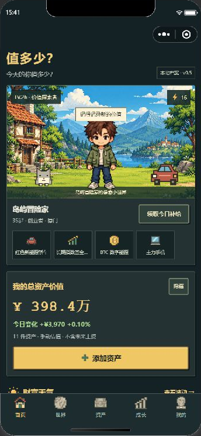

# 值多少？

> 今天的你值多少？

一个可爱像素 RPG 风格的个人资产微信小程序原型。它把房产、车辆、金融资产、数码产品、收藏、会员和宠物等“拥有的一切价值”，转化为数字角色身边的装备与个人世界。

## V0.5：像素角色与持有成本

- 首页换为原创生成的像素村庄和人物素材，4种发色×4种外套配色；首页、换装预览使用同一套角色图片。
- 深色森林面板、金色主按钮、统一选中态和表单；首页滚动时为微信胶囊保留独立安全区。
- 开始持有日期：新资产默认今天，旧资产不虚构购买日期。日均持有成本 = 获得成本 ÷ 持有天数；按自然日差计算，同日按1天，不是投资收益，也不是当前估值除以天数。
- 编辑资产时实时预览持有天数/日均成本，资产列表同步展示；可修改真实日期，不能选未来日期。
- 修复零估值被留空、归档资产编辑后被意外恢复、分类筛选丢失、零收入沿用旧数值、换装草稿被装备开关覆盖等问题。
- 已有12页的模拟器检查、回归测试与原生编译检查。手机实机验收和原参考图逐像素还原尚不等于完成；详见 [验收记录](design-qa.md)。



当前仍为本地演示版；GitHub同步不等于微信正式版上线。当前配置为测试号，不能上传正式版本。

## V0.4：想拥有、已拥有、准备告别

V0.4.2 按钮整理：首页角色场景与文字、签到按钮分离，按微信胶囊位置预留顶部空间。各页操作统一为主按钮、次按钮、紧凑按钮和方形图标按钮，长文案可换行，保存中统一禁用态；底部保留安全区。共用样式位于 `styles/buttons.wxss`，项目检查会校验每个原生按钮是否使用共享样式。

V0.4.1 视觉更新：补齐五个底部导航的默认/选中图标；资产分类、角色配件、天气、愿望、闲置、操作按钮与成长路线统一为原创像素 PNG。共35张96×96透明图标，运行时无需联网或图标字体。图标总览见 [icons-v0.4.1.png](docs/icons-v0.4.1.png)。

- 买前问问：创建愿望卡，选择买/等等/不买，改票与查看本地结果。
- 我的决定：先等等、不买、重新开启；填写实际支付金额后确认入库，避免重复创建资产。
- 闲置背包：从已有数码、收藏、车辆选择物品，记录期望价、成色和备注；支持撤回与确认转出。
- 首页与资产页提供新入口，沿用像素角色、配色、边框和交互动效；首页直接展示财富天气。

**这是本地体验版。** 示例卡票数已标注为演示，自己创建的卡从0票开始。尚无跨设备投票、公开闲置发布或买家联系；分享为体验预览。闲置展示不改变资产总值，确认转出后才归档，不记录收款。

完整需求与验收路径：[V0.4 需求](docs/requirements-v0.4.md)。

产品只做资产记录、估值、统计、变化追踪和展示，不提供买入、卖出、兑换、撮合、支付或其他交易能力。

## 当前可体验

- 当前资产首页：总价值、今日变化、累计成长、价值世界
- 像素人物：首页首屏展示人物、等级、能量、互动对白与四个资产配件
- 角色互动：点击人物回应、每日签到、连续签到和能量本地保存
- 像素特效：人物回应、金币反馈、世界探索、装备反馈和页面入场动画
- 角色外观：昵称、年龄、职业、城市、发色与服装可修改
- 五页主导航：首页、世界、资产、成长、我的
- 资产档案：10 类资产、获得成本、当前估值、今日变化、人物装备开关
- 编辑和归档资产档案；归档后停止统计和展示，不代表卖出
- 收入记录新增/删除与每日资产快照
- 资产世界：区域数量、展示配件数量、繁荣度和分类资产展示
- 资产世界互动：区域切换、繁荣度进度条和随机探索资产
- 财富波动：按资产世界汇总今日涨跌，可点击天气与分类查看解读
- 未来曲线：收入、年化增长、收入增长和年数模拟，支持三条冒险路线与传送门动效
- 数字角色名片：完整金额、区间金额或隐藏金额三种隐私级别
- 微信原生分享：按隐私设置分享数字角色名片文案
- 本地数据：首次启动自动写入演示数据，之后保存在微信本地缓存

## 在微信开发者工具运行

1. 打开微信开发者工具。
2. 选择“导入项目”。
3. 项目目录选择本文件夹：`D:\CodexProjects\值多少-miniprogram`
4. 项目已配置当前小程序 AppID；不要把 AppSecret 写进前端文件。
5. 点击“编译”即可预览。

## 本地检查

```powershell
cd 'D:\CodexProjects\值多少-miniprogram'
npm.cmd test
npm.cmd run check
```

## 首版产品边界

当前版本用于验证“角色首页 → 角色互动 → 添加资产 → 价值与装备联动 → 查看波动/未来 → 分享名片”的核心闭环。股票、黄金、加密货币、手机和汽车等联网行情 API 尚未接入；选择“自动行情”会明确提示下一阶段开放，不会伪装成实时数据。

正式接入 API 时应通过服务端或微信云函数统一代理，密钥不能写在小程序前端。手机和汽车二手价通常不存在稳定免费的通用官方接口，需要独立确认授权数据源或先采用折旧模型。
