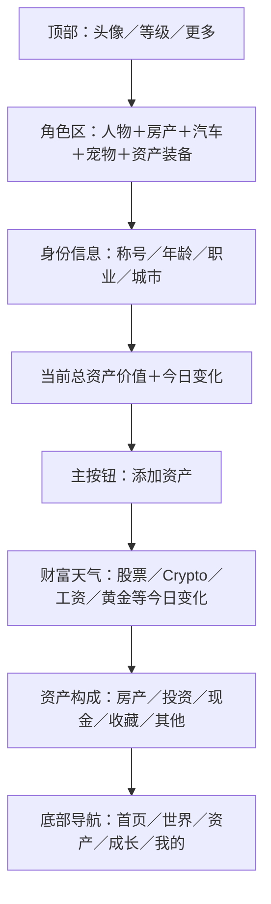
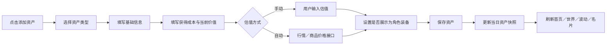
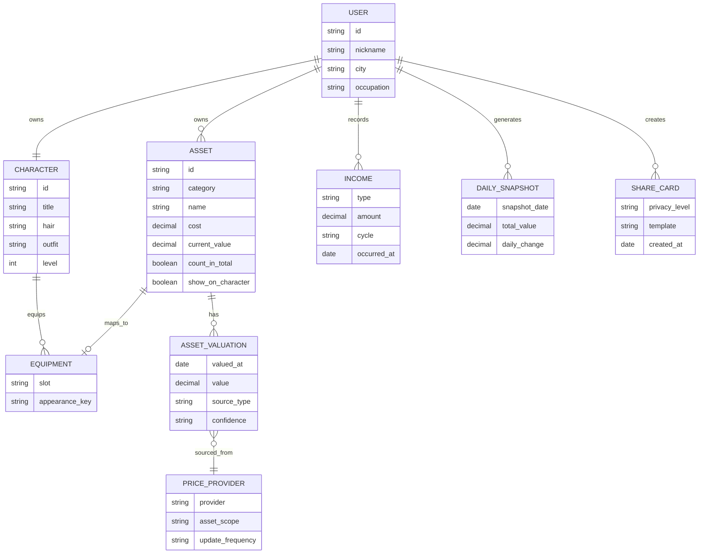
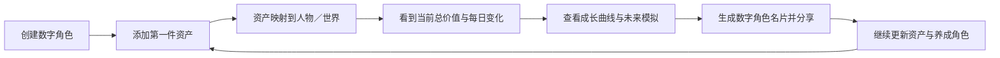

# 《值多少？》低保真产品结构 V1

> 当前阶段只确认产品结构、核心流程与数据边界，不定义最终视觉样式。
>
> 产品边界：只做资产记录、估值、统计、变化追踪与展示，不提供任何交易功能。

## 1. 产品总结构

```mermaid
flowchart TB
    APP["值多少？小程序"]

    APP --> HOME["首页｜今天的你值多少？"]
    APP --> WORLD["世界｜我的资产世界"]
    APP --> ASSETS["资产｜拥有的一切"]
    APP --> GROWTH["成长｜过去与未来"]
    APP --> ME["我的｜数字角色名片"]

    HOME --> H1["数字角色与身份"]
    HOME --> H2["当前总资产价值"]
    HOME --> H3["添加资产主入口"]
    HOME --> H4["财富天气／今日波动"]
    HOME --> H5["资产构成"]

    WORLD --> W1["像素世界总览"]
    WORLD --> W2["资产分类场景"]
    WORLD --> W3["建筑／坐骑／宠物／装备"]
    WORLD --> W4["点击场景查看对应资产"]

    ASSETS --> A1["资产分类筛选"]
    ASSETS --> A2["资产列表"]
    ASSETS --> A3["资产详情"]
    ASSETS --> A4["新增／编辑／归档资产记录"]
    ASSETS --> A5["估值来源与更新时间"]

    GROWTH --> G1["历史资产曲线"]
    GROWTH --> G2["收入记录"]
    GROWTH --> G3["每日资产快照"]
    GROWTH --> G4["未来增长模拟"]

    ME --> M1["人物基础资料"]
    ME --> M2["发型／服装／装饰"]
    ME --> M3["资产装备管理"]
    ME --> M4["数字角色名片"]
    ME --> M5["隐私与分享设置"]
```

## 2. 首页低保真结构

## 3. 添加资产核心流程

### 首批资产类型

| 大类 | 包含内容 | V1 估值方式 |
|---|---|---|
| 房产 | 住宅、商铺、写字楼 | 手动 |
| 汽车 | 轿车、SUV、新能源车 | 手动 |
| 金融 | 股票、基金、黄金、外汇 | 手动，后续接行情 |
| 数字资产 | BTC、ETH、数藏、游戏资产 | 手动，后续接行情 |
| 数码产品 | 手机、电脑、相机 | 手动，后续接折旧模型／商品数据 |
| 收藏品 | 手表、潮玩、艺术品、酒 | 手动 |
| 宠物 | 猫、狗及其他伙伴 | 不计入货币总值，记录陪伴价值 |
| 会员权益 | 健身、航空、酒店、软件会员 | 按剩余期限折算 |
| 现金 | 银行存款、支付账户 | 手动 |
| 其他 | 公司股权、项目权益、自定义资产 | 手动 |

## 4. 数据结构

## 5. MVP 业务闭环

## 6. V1 边界

### V1 必须完成

- 创建与编辑数字角色
- 手动添加、编辑、归档资产记录
- 资产分类、总值与价值变化计算
- 工资与其他收入记录
- 每日资产快照
- 首页财富天气
- 未来增长模拟
- 资产映射到人物或世界
- 数字角色名片与隐私等级

### V1 暂不实现

- 任何买入、卖出、兑换、撮合或支付交易
- 交易订单、持仓下单、资金账户和钱包
- 银行账户直连
- 自动识别所有手机、汽车和收藏品价格
- NFT 上链与链上资产能力
- 资产社区与排行榜
- 自动投资建议
- 复杂家庭资产协作

## 7. 开发顺序

1. 确认页面结构、资产分类和价值计算口径。
2. 完成角色、资产、估值、收入和快照数据模型。
3. 打通“添加资产 → 总值变化 → 人物装备变化”。
4. 完成波动、构成和成长页面。
5. 完成分享名片和隐私设置。
6. 最后再进入高保真像素 UI 与外部行情 API。

## 8. 明确不做的交易能力

资产在本产品中是“统计对象”和“展示对象”，不是可交易商品。

- “添加资产”表示创建一条资产档案，不是买入。
- “归档资产”表示不再展示或统计该记录，不是卖出。
- “成本”表示获得该资产时的历史投入，只用于计算价值变化。
- “当前价值”来自手动估值或外部行情，只用于统计和展示。
- 产品不承接资金，不保存支付账户，不生成订单，不撮合交易。
